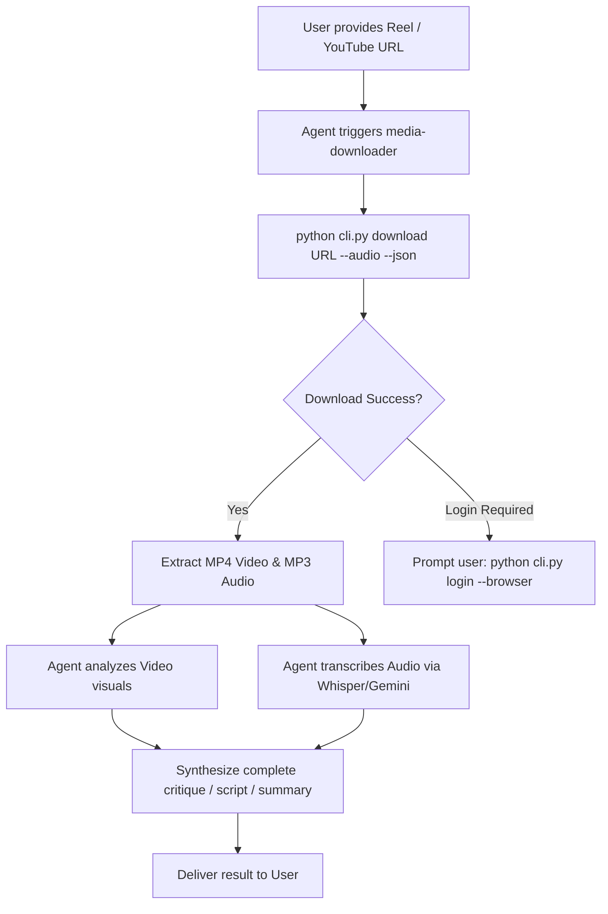

# AI Agent Integration Guide

This guide explains how autonomous coding and research agents (Cursor, Claude Code, Codex, Antigravity, OpenCode, etc.) can best utilize the Media Downloader skill.

---

## 🎧 The "Agent Deafness" Problem

Most LLM-based agents can browse the web or take screenshots, but:
1. Web browsers used by agents (like Playwright headless or Chrome DevTools Protocol) do not transmit continuous system audio to the LLM.
2. Most video hosting platforms (especially Instagram) use proprietary progressive streaming, blob URLs, and DRM-style protections that cannot be scraped with a simple `curl` or `fetch`.
3. Consequently, when a user asks:
   - *"Listen to this reel and tell me why the hook worked."*
   - *"Transcribe the exact script from this YouTube short."*
   - *"What music or background audio is this creator using?"*
   - *"Critique the voiceover delivery and pacing of this video."*
   The agent fails unless it can access the raw audio file.

---

## 🛠️ Typical Agent Workflow



### Example Agent Ingestion with Whisper / Python
Once `audio_path` is returned in the JSON:

```python
# Optional agent script to transcribe the downloaded audio using faster-whisper or openai-whisper
from faster_whisper import WhisperModel

model = WhisperModel("base", device="cpu", compute_type="int8")
segments, info = model.transcribe(audio_path, beam_size=5)

transcript = " ".join([segment.text for segment in segments])
print("Spoken Transcript:", transcript)
```

### Example Agent Multimodal Video Inspection
Once `video_path` is returned:
- Agents with native video file upload (like Gemini multimodal or Claude video support) can ingest the `.mp4` file directly.
- The agent can inspect visual keyframes, title text animations, cuts, overlays, and face reactions.

---

## 📋 JSON Output Specification

When invoking `python cli.py download "<URL>" --json`, the agent can rely on the following schema:

```json
{
  "status": "success",
  "platform": "instagram" | "youtube",
  "media_type": "reel" | "short" | "video",
  "url": "https://...",
  "video_path": "/absolute/path/to/video.mp4",
  "audio_path": "/absolute/path/to/audio.mp3",
  "metadata_path": "/absolute/path/to/metadata.json",
  "duration_seconds": 24.5,
  "views": 150000,
  "likes": 9800,
  "author": "creator_handle",
  "caption": "Full caption text or video description",
  "date": "2026-05-15"
}
```

If the video cannot be downloaded (e.g. invalid URL or private post):
```json
{
  "status": "error",
  "url": "https://...",
  "error": "Descriptive error message explaining the failure."
}
```
